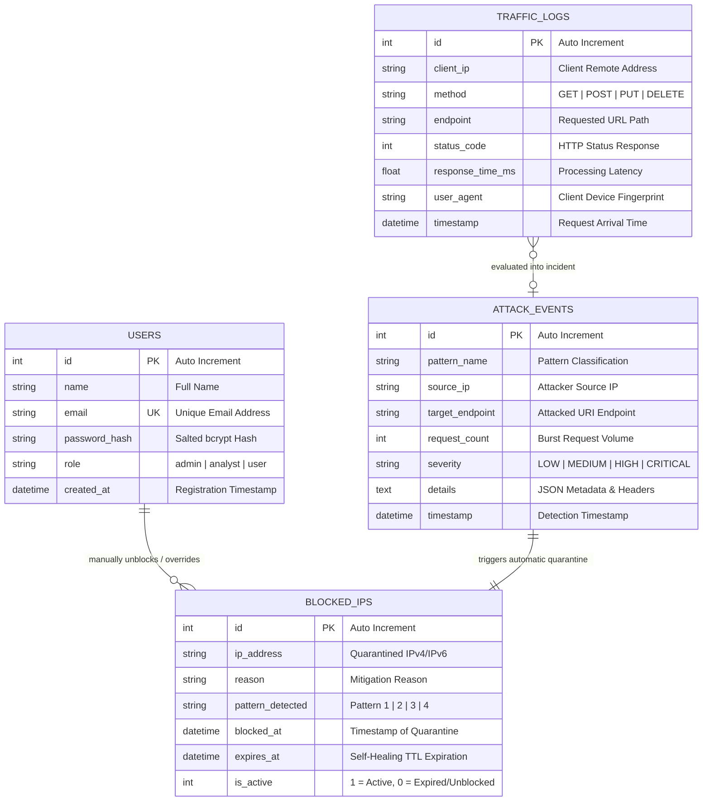
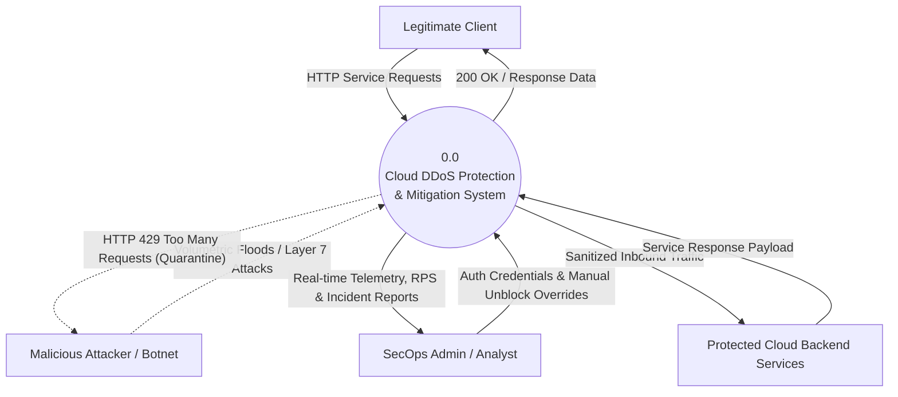
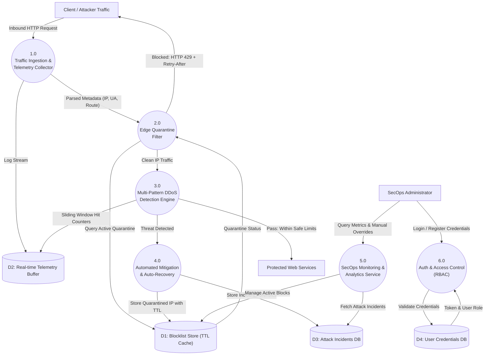
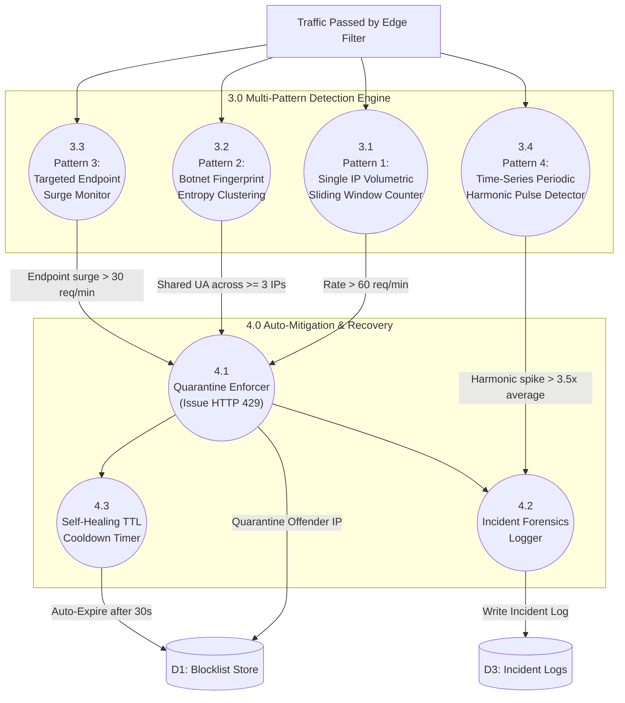

# System Architecture Diagrams: ERD & Data Flow Diagrams (DFD)
## Cloud DDoS Protection System for Cloud Infrastructure
**Source/Sponsor**: SAG, DRDO / Ministry of Defence  
**Domain**: Cybersecurity & Cloud Infrastructure  

---

## 1. Entity-Relationship (ER) Diagram

---

## 2. Data Flow Diagram (DFD) Level 0: Context Diagram

---

## 3. Data Flow Diagram (DFD) Level 1: Subsystem Decomposition

---

## 4. Data Flow Diagram (DFD) Level 2: Detection & Mitigation Engine

